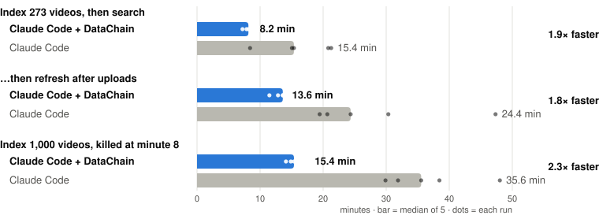
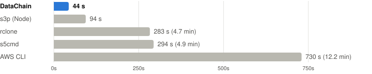

<!-- DRAFT: numbers come from the agent evals on the eval branch (Oct 2026).
     Re-measure every number on the released version before merging. -->

#  DataChain

[](https://pypi.org/project/datachain/)
[](https://pypi.org/project/datachain)
[](https://github.com/datachain-ai/datachain/actions/workflows/tests.yml)
[](https://github.com/datachain-ai/datachain-agent-evals)

**Fast data pipelines for robotics and physical AI.**<br>
**Your coding agent finishes 2× faster.**

A Python library for files in S3, GCS and Azure: video, images, audio, sensor logs, robot episodes.

```bash
pip install datachain
datachain skill install --target claude      # or: codex, cursor, copilot
```

Ask your agent:

```text
What's in s3://noaa-goes16/ABI-L1b-RadC/2024/ ? Count files and bytes per day and per band.
```

It writes this and runs it:

```python
from collections import Counter
import datachain as dc

files, size = Counter(), Counter()
for f in dc.list_storage("s3://noaa-goes16/ABI-L1b-RadC/2024/", versions=False):
    key = (
        f.path.split("/")[2],
        f.name.split("_")[1][-2:],
    )  # day, band ("...-M6C01" -> "01")
    files[key] += 1
    size[key] += f.size
```

1.7 million files in 27 seconds, one pass, nothing saved. `aws s3 ls --recursive` takes 7 minutes for the same bucket.

<sub>Measured from a laptop on home internet, us-east-1 bucket, median of 2 runs.</sub>

## 2× faster on real work

The same agent, the same task, with and without DataChain:

<p align="center"></p>

<p align="center"><i>Claude Code + Opus 5.5 on dashcam video in S3, 8-CPU sandbox. Bar = median of 5 runs, dots = each run.</i></p>

## The problem

Coding agents are good at code and at tables. Give one a bucket of video or robot episodes, and most of its time
goes into plumbing. In our runs, Claude Code without DataChain:

- **rebuilt the plumbing every time.** Download pools, frame batching, checkpoint files: 240–300 lines before the
  first answer.
- **relearned the video.** Rotation, variable frame rates, timestamps: 2–12 minutes per session.
- **lost the work when it crashed.** Killed at minute 8, it had saved 0–223 of 1,000 videos.
- **redid everything when files changed.** After new uploads, one run spent 22 minutes re-checking all 343 videos.

DataChain is that plumbing, already fast. And it keeps what was computed.

## Try it on video (8 minutes)

```bash
pip install "datachain[video,torch]" open_clip_torch      # video needs ffmpeg
```

Paste into your agent:

```text
Our dashcam videos are in s3://dc-readme/fleet-cameras/2025-12/front/. Make them searchable: one frame per
second, CLIP embeddings, each frame with its video and timestamp. Then find the 10 moments that best match
"a pedestrian crossing in front of the car".
```

Kill it halfway and ask again: it resumes. Add files to your own bucket and ask again: only the new ones are
processed.

## Measured

Same Claude Code + Opus 5.5, same task, same 8-CPU sandbox, real public data. The DataChain runs add the skill and
one line, "Use DataChain for this." Median of 5 runs; every answer checked by an independent verifier.

| Task | Claude Code alone | + DataChain | |
|---|---:|---:|---|
| Index 1,000 videos; the process is killed at minute 8; finish the job | 35.6 min · 4/5 correct | **15.4 min** · 5/5 | **2.3× faster** |
| Index 273 dashcam videos at 1 fps with CLIP, then search them | 15.4 min | **8.2 min** | **1.9× faster** |
| The same, then refresh after uploads, overwrites and deletions | 24.4 min | **13.6 min** | **1.8× faster** |
| One-off metadata questions (incl. 3 held-out tasks) | | | same to 1.3× slower |

- **Predictable.** On the search task, the agent took 7.2–8.9 min with DataChain and 8.4–21.3 min without.
- **Less to read.** 1.7–2.4× fewer tokens, 2–3× less code left behind.
- **Picked without being asked.** With the skill installed and DataChain never mentioned in the prompt, the agent
  chose it in 10 of 12 runs.

Prompts, verifiers, raw session logs and the rerun script are in
[datachain-agent-evals](https://github.com/datachain-ai/datachain-agent-evals).

## How it's fast

Three layers. Each one is something your agent would otherwise rebuild, slower, every session.

**1. Fast primitives.** The operations an agent would write by hand, built to beat the tools it would reach for.

<p align="center"></p>

<p align="center"><i>Listing 2.03M objects in S3 into a saved, queryable dataset (DataChain) or to stdout (the others). 8-CPU sandbox, out of region. 10.5M object versions: DataChain 3.8 min, rclone 38 min, s5cmd 39 min.</i></p>

Batched inference with `map(batch=32)`: CLIP over 500 images runs 2.5× faster than one image per call.

**2. State: nothing valid is computed twice.** Every row records which version of which file it came from
(`etag`, `version`) and which code produced it.
- A job killed halfway resumes from its finished rows. After the crash, the second session took 442 s with
  DataChain and 1,653 s without.
- New, overwritten and deleted files become a delta (`delta=True`). Only the changes are processed, and the
  result equals a full recompute.

**3. Context for your agent.** Every saved dataset carries what an agent needs to reuse it correctly: its schema,
the code that produced it, its sources and their file versions, the datasets it was built from, row count and
when it was computed. All of it is already in the local database: no LLM calls, no setup, answered in milliseconds.

```bash
$ datachain dataset ls                      # what has been computed in this project
$ datachain show dashcam_frames --schema --script
```

In every follow-up session of the video tasks (25 of 25), the agent began with `datachain dataset ls` and found
the earlier work.

## What your agent writes

```python
import datachain as dc

(
    dc.read_storage(
        "s3://dc-readme/oxford-pets-small/images/*.jpg",
        type="image",
        anon=True,
        update=True,
        delta=True,
    )  # re-run = only new and changed files
    .settings(parallel=8, prefetch=16)  # 8 workers; downloads overlap compute
    .map(emb=ClipEmbed(), batch=32)  # your model, batched
    .save("pet_embeddings")  # typed, versioned dataset
)
```

<details><summary><code>ClipEmbed</code> and <code>clip_text</code>: ordinary PyTorch</summary>

```python
class ClipEmbed(dc.Mapper):
    def setup(self):  # once per worker
        import open_clip

        self.model, _, self.pre = open_clip.create_model_and_transforms(
            "ViT-B-32", pretrained="laion2b_s34b_b79k"
        )

    def process(self, file: list[dc.ImageFile]) -> list[list[float]]:
        import torch

        x = torch.stack([self.pre(f.read().convert("RGB")) for f in file])
        with torch.no_grad():
            e = self.model.encode_image(x)
        return (e / e.norm(dim=-1, keepdim=True)).tolist()


def clip_text(text: str) -> list[float]:
    import open_clip, torch

    model, _, _ = open_clip.create_model_and_transforms(
        "ViT-B-32", pretrained="laion2b_s34b_b79k"
    )
    with torch.no_grad():
        e = model.encode_text(open_clip.get_tokenizer("ViT-B-32")([text]))[0]
    return (e / e.norm()).tolist()
```
</details>

The next session, from any agent:

```python
query = clip_text("a dog on a beach")  # the same model's text side
dc.read_dataset("pet_embeddings").similarity_search("emb", query, k=10).show()
```

Video works the same way: `file.sample_frames(fps=1)` yields frames at the right times, even when the frame rate
varies.

## When to use it, and when not

**Use it** when the work is thousands of files × a real per-file cost (decoding, a model), or when it will run
again: tomorrow's uploads, a crashed job, a follow-up question.

**Skip it** for a one-off question a single `ffprobe` or `aws s3 ls` answers in seconds. The skill steers your
agent toward the one-liner there; it still over-reaches now and then (1 of 12 runs).

## Core ideas

- **Files stay where they are.** A row holds a pointer (`source`, `path`, `etag`, `version`) and typed fields
  computed from the file. Nothing is copied.
- **Python in, typed columns out.** The UDF's return type becomes the schema. Nested fields are queryable as
  `emb`, `info.fps`.
- **SQL after the expensive step.** Filters, joins, group-bys and vector search run in the local database
  (SQLite; ClickHouse in Studio) without touching the files.
- **Every `.save()` is a version** with lineage. That is what makes resume and delta automatic.
- **No LLM calls, no server, no account.** The library never calls a model on its own; your agent does the thinking.

Docs: [datachain.ai/docs](https://www.datachain.ai/docs) · For agents: [llms.txt](https://www.datachain.ai/docs/llms.txt) ·
Skill: [`src/datachain/skill/datachain`](src/datachain/skill/datachain/SKILL.md)

## Teams: Studio

The same datasets shared across a team and its agents, compute on many machines, and access over MCP. Studio
also keeps a knowledge base: LLM-written summaries of every dataset and bucket, so a team's agents can find the
right data across projects.
[studio.datachain.ai](https://studio.datachain.ai)

## Community

[Contributing](https://www.datachain.ai/docs/contributing) · [Issues](https://github.com/datachain-ai/datachain/issues) ·
[Discord](https://discord.com/invite/datachain)
