# <a class="main-header-link" href="/" >  DataChain</a>

Curate training data and explore large media collections

  
  
  
  

**Curate training data and explore large media collections.**

Prepare training and evaluation datasets for Physical AI, robotics and multimodal models from images,
video, audio and sensor recordings in S3, GCS, Azure or local storage. Write Python or give your coding
agent a task; DataChain handles parallel workers, download overlap and checkpoints, and saves typed,
versioned results for the next question.

Use metadata and model outputs to curate selections, investigate failures and find gaps in data coverage.
Inventory millions or billions of objects using storage metadata before reading file contents.
Optional Studio adds shared datasets and job tracking, with or without a compute cluster.

## Get started

- **[🤖 Agents](getting-started/agents.md)** - task-oriented recipes for Claude Code, Codex, and Cursor
- **[🐍 Python](getting-started/python.md)** - full control over data processing
- **[💡 Concepts](concepts/index.md)** - saved datasets, typed schemas and the Compute Engine
- **[🧩 Use Cases](use-cases/index.md)** - file-processing and saved-result workflows

  

